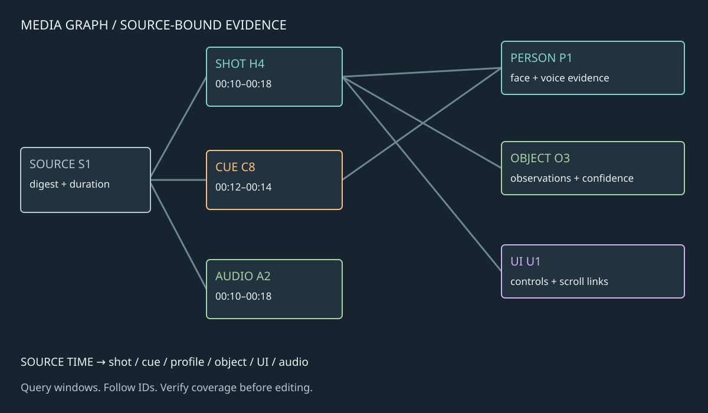

# Агенты, MCP и граф медиа

[English](Agents.md) · [ag-media-studio](../../README.md)



Условный граф с ID и таймкодами. Исходник и происхождение наблюдений остаются доступными через ссылки.

## Память для повторного анализа

Установи agent-memory и сценарии Studio в папку, которую открываешь в агенте. Из исходников запусти python3 skills/install.py --project ПУТЬ --client codex. В установленной Studio тот же скрипт лежит рядом с исходниками: Contents/Resources/studio/skills/install.py в macOS, source/skills/install.py в Windows, /opt/ag-media-studio/studio/skills/install.py в Linux. Открой в агенте новую сессию. При повторе задачи агент сначала сверяет прошлый вывод с текущим снимком, таймкодами и покрытием.

## Сначала найти инструмент

Конфигурация локального MCP и установка навыков описаны в `docs/AGENT-SETUP.md` и `skills/README.md` в репозитории. Для нативной студии используй команду своей платформы из инструкции.

Каталог `media_catalog` ищет актуальные инструменты. Ресурс `ag-media-studio://catalog` показывает те же регистрации. После обновления студии переподключи MCP.

```text
media_catalog(category="ui", query="scroll", include_schema=true)
media_catalog(category="graph", include_schema=true)
```

## Работа по временным окнам

- Получи список/overview доступных графов и проверь источник, SHA, длительность и покрытие.
- Найди слова или тип узла через `media_graph_search`; затем запроси ограниченное окно `media_graph_timeline`.
- Через `media_graph_node` уточни входящие/исходящие ссылки. Не считай отсутствие узла доказательством отсутствия объекта в исходнике.
- Используй `media_graph_frame` для исходного кадра с техническим слоем и `media_graph_audio` для нужного звукового фрагмента.
- Для зарегистрированных интерфейсов фильтруй `kind=ui`; локальные скриншоты анализируют `screen_analyze` и `screen_scroll`. Черновой детектор не доказывает роль элемента.

## Браузер и внешний агент

WebMCP использует текущую страницу и её состояния. Внешний stdio MCP работает с локальными файлами и сервером по существующим контрактам. Наличие URI в wiki не предоставляет доступ или разрешение на удаление, публикацию и отправку данных.

## Что передавать следующему агенту

- ID графа/снимка и источник материала, для дорожки — её связь с исходником.
- Интервал времени, интересующий тип узла и нужные поля.
- Наблюдения, уверенность и основания связи отдельно от выводов агента.
- Какие слои ещё догружаются, пропущены или требуют проверки.

- [Схемы интерфейса](Interface-ru.md)
- [Полный индекс модулей](Modules-ru.md)
