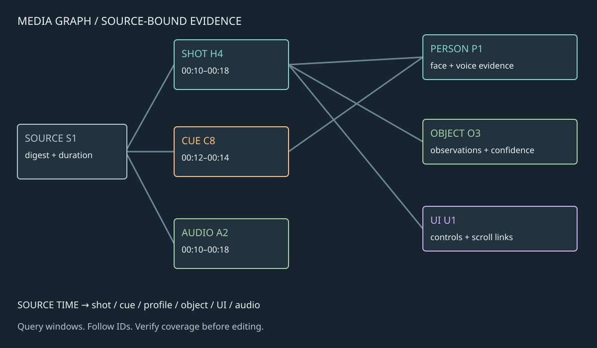

# Agents, MCP and the media graph

[Русский](Agents-ru.md) · [ag-media-studio](../../README.md)



Schematic IDs and source timestamps; links retain provenance.

## Memory for repeat analysis

Install agent-memory and the Studio scenario skills into the folder you open in your client. From source, run python3 skills/install.py --project PATH --client codex. Desktop packages include the same script at Contents/Resources/studio/skills/install.py on macOS, source/skills/install.py on Windows, and /opt/ag-media-studio/studio/skills/install.py on Linux. Open a fresh client session. For a repeat request, match saved findings against the current snapshot, timecodes, and coverage first.

## Discover before calling

See `docs/AGENT-SETUP.md` and `skills/README.md` in the repository for local MCP setup and scenario skills. Use the corresponding platform command for an open desktop app.

Use `media_catalog` to discover current tools. The `ag-media-studio://catalog` resource publishes the same inventory. Reconnect MCP after updating Studio.

```text
media_catalog(category="ui", query="scroll", include_schema=true)
media_catalog(category="graph", include_schema=true)
```

## Navigate bounded time windows

- Read overview/list and verify source digest, duration and coverage.
- Search with `media_graph_search`, then read a bounded `media_graph_timeline` window.
- Use `media_graph_node` for references. Missing graph nodes do not prove a source object is absent.
- Use `media_graph_frame` for an original frame with technical layers and `media_graph_audio` for audio.
- Use `kind=ui` for recorded interfaces. Local screenshot tools are `screen_analyze` and `screen_scroll`; draft labels are not verified control roles.

## Browser versus external agents

WebMCP operates on the current page. The external stdio server uses local files and the existing loopback contracts. Documentation links do not grant permission to delete, publish or transmit data.

## Handoff fields

- Snapshot/graph ID and source material; source association for each track.
- Source-time interval, node kind and needed fields.
- Observed confidence and association basis separate from agent interpretation.
- Incomplete, skipped and pending layers.

- [Interface diagrams](Interface.md)
- [Complete module index](Modules.md)
