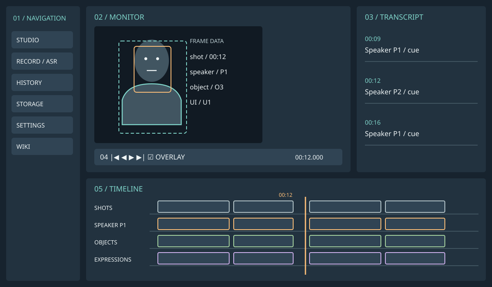

# Медиа как данные и монтаж

[English](Home.md) · [ag-media-studio](../../README.md)

ag-media-studio — локальная студия анализа видео и звука, расшифровки, работы со спикерами и синтеза. Прежнее имя — Voice Studio. Можно просматривать результат в редакторе или передавать агентам компактный граф с исходником и таймкодами.

Эта wiki объясняет, что делает каждый слой, где находится его реализация и как проверить результат. Схемы ниже — условные макеты интерфейса, а не кадры пользовательских роликов.



Нажми на схему, чтобы открыть SVG и увеличить детали. 01 — навигация; 02 — монитор; 03 — расшифровка; 04 — транспорт и разметка; 05 — монтажная шкала.

## С чего начать

- [Запуск и совместимость](Quickstart-ru.md)
- [Карта модулей и полный индекс исходников](Modules-ru.md)
- [Как читать интерфейс и технические слои](Interface-ru.md)
- [Инструменты для агентов](Agents-ru.md)

## Как обновлять документацию

Контент хранится в `docs/wiki/content.json`, схемы — в `docs/wiki/assets/`. Сборка создаёт Markdown-страницы и HTML с одной и той же информацией. Варианты RU/EN связаны переключателем. По аналогии с ag-design wiki версионируется рядом с кодом; публикация на GitHub не выполнялась.

```text
python3 scripts/build_wiki.py
python3 scripts/build_wiki.py --check
```

HTML доступен по `/wiki`. Страница не запускает модели и не читает записи; документация открывается в новой вкладке и сохраняет рабочую страницу студии.
