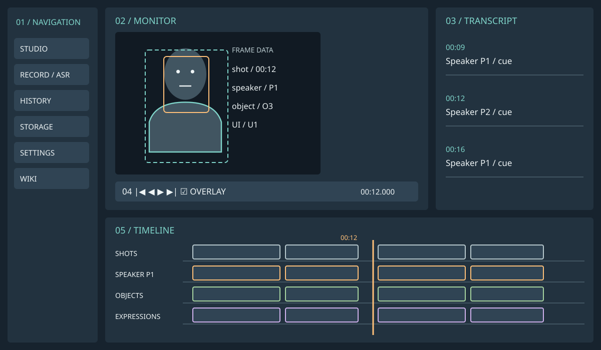

# Media as data and an editing workspace

[Русский](Home-ru.md) · [ag-media-studio](../../README.md)

ag-media-studio is a local workspace for video and audio analysis, transcription, speakers and speech synthesis. Its previous name is Voice Studio. People use the editor; agents navigate a compact graph with source provenance and timestamps.

This wiki explains layer responsibilities, source locations and result checks. Illustrations are schematic UI examples, never frames from customer videos.



Open the SVG to zoom. 01 navigation; 02 monitor; 03 transcript; 04 transport and overlays; 05 timeline.

## Start with a task

- [Run and compatibility](Quickstart.md)
- [Module map and complete source index](Modules.md)
- [Interface and technical layers](Interface.md)
- [Agent tools](Agents.md)

## Documentation maintenance

Edit `docs/wiki/content.json` and vector assets under `docs/wiki/assets/`. One build generates the Markdown mirror and the offline HTML edition. RU/EN pages link to each other. As in ag-design, wiki files live alongside code; no GitHub publication has been performed.

```text
python3 scripts/build_wiki.py
python3 scripts/build_wiki.py --check
```

Open `/wiki?ui=en`. The wiki does not execute models or read recordings. Its navigation link opens a separate tab, keeping the active studio workspace mounted.
