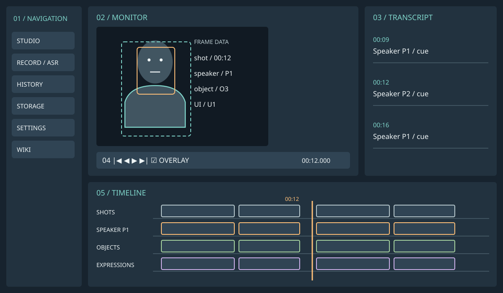
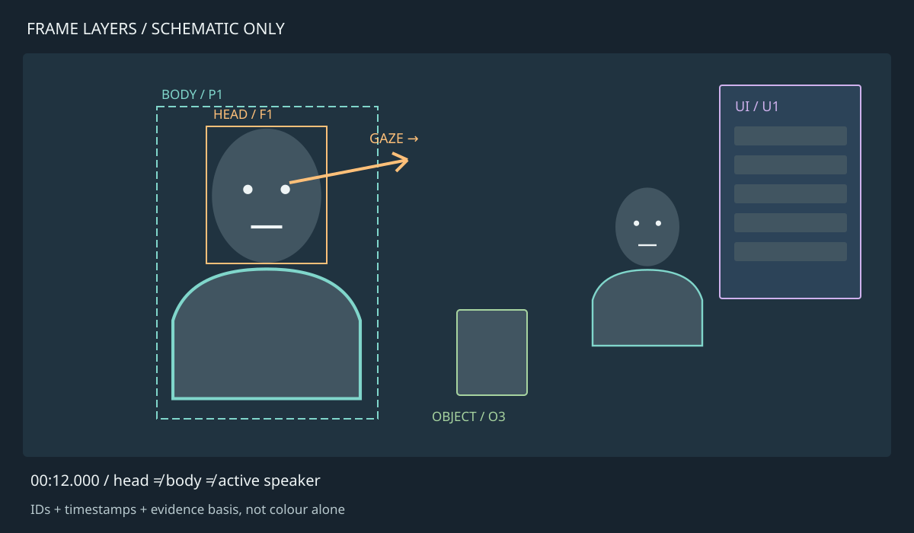

# Области экрана и технические слои

[English](Interface.md) · [ag-media-studio](../../README.md)

Схема интерфейса. Цветные элементы обозначают тип данных и не являются результатом распознавания.

| Область | Действие и реализация |
| --- | --- |
| Навигация | Студия, запись/транскрипция, история, хранилище, настройки. `studio-navigation.js`, `studio-shell.js` |
| Монитор | Исходный video и разметка на одном времени. `editor-workspace.js`, `video-overlay.js` |
| Транспорт | Воспроизведение, шаг по сетке анализа, иконки технического режима, скачивания и масок под видео. `video-shortcuts.js` |
| Расшифровка | Сворачиваемая правая панель, реплики, редактор и ссылки на профили. `transcript-inspector.js`, `transcript-editor.js` |
| Монтажная шкала | Слои, перемещение времени, fit, масштаб и плотность. `video-timeline.js` |
| Профили | Спикер и предмет: основания связи, наблюдения, мини-шкалы. `speaker-profile-dialog.js`, `video-object-profile.js` |

## Как читать рамки

Оранжевый — голова/лицо; бирюзовый — фигура; зелёный — предмет; фиолетовый — интерфейс. Сопоставляй ID и время, а не только цвет.

- Голова и фигура — разные рамки. Слой взгляда оценивает направление, а не точку внимания.
- Подпись спикера должна соответствовать реплике, профилю и рамке на текущем времени.
- Метки выражений — оценки видимого выражения классификатором. Они не доказывают переживание, намерение или правдивость.
- Для спорного предмета проверь исходную метку, уверенность, другие появления и вложенные объекты.
- При клике на выражение или предмет проверяй исходный кадр с техническим слоем. Пространственный bbox не является маской сегментации.

## Управление

- Пробел — запуск/пауза, если фокус не в текстовом поле.
- Стрелки транспорта — шаг по подписанной сетке; Shift + стрелка — одна секунда.
- Escape закрывает активный диалог; рабочая область сохраняет состояние.
- Настройки позволяют выбрать retro/modern/editor и светлую/тёмную тему. Wiki следует системной светлой/тёмной теме.

- [Звук и конвейер](Pipeline-ru.md)
