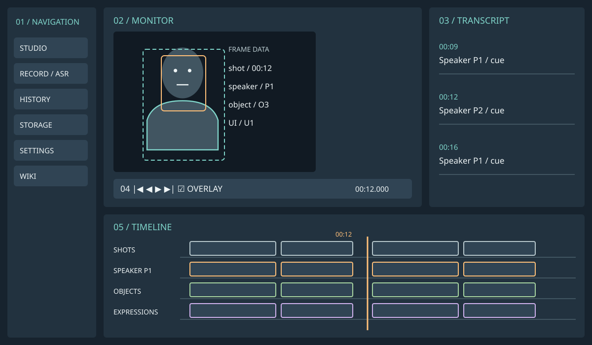
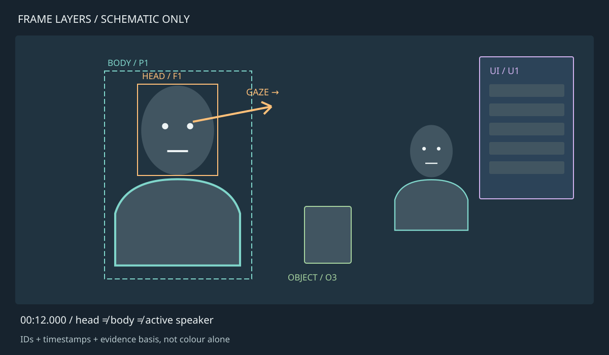

# Screen regions and technical layers

[Русский](Interface-ru.md) · [ag-media-studio](../../README.md)

Colours indicate data types; this is not a recognition result.

| Region | Responsibility and source |
| --- | --- |
| Navigation | Studio, recording/transcription, history, storage, settings: `studio-navigation.js`, `studio-shell.js` |
| Monitor | Native video and source-clock overlays: `editor-workspace.js`, `video-overlay.js` |
| Transport | Playback, labelled analysis-grid step and technical-overlay, download and clothing-mask icons below the video: `video-shortcuts.js` |
| Transcript | Collapsible inspector and cue editing: `transcript-inspector.js`, `transcript-editor.js` |
| Timeline | Layers, seeking, fit, zoom and density: `video-timeline.js` |
| Profiles | Speaker/object evidence and appearance timelines: `speaker-profile-dialog.js`, `video-object-profile.js` |

## Read the technical layer

Orange: head/face. Teal: body. Green: object. Purple: interface. Use IDs and source time as well as colour.

- Head and body boxes are different. Gaze is a direction estimate, not an attention point.
- The cue, profile and active overlay should agree on speaker identity.
- Classifier-estimated facial expressions do not establish internal feelings, intent or truthfulness.
- For uncertain objects inspect the original label, confidence, other appearances and contained objects.
- Open the original frame when inspecting an expression or object. A bounding box is not a segmentation mask.

## Controls

- Space plays/pauses when focus is outside text editing.
- Transport arrows use the labelled analysis grid; Shift + arrow seeks one second.
- Escape closes an active dialog while preserving the workspace.
- App settings offer retro/modern/editor with light/dark modes. The wiki follows the system light/dark theme.

- [Audio and processing](Pipeline.md)
