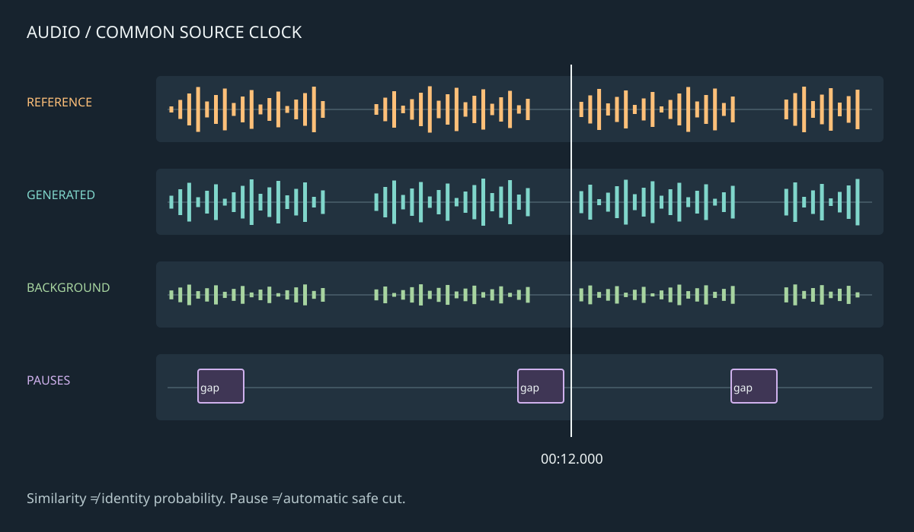

# Анализ, звук и синтез

[English](Pipeline.md) · [ag-media-studio](../../README.md)

## От файла к слоям

- HTTP проверяет запрос и передаёт источник в `speech/media_transcript.py`.
- FFmpeg подготавливает звук. Sherpa выделяет голосовые группы, Whisper получает текст и времена; проблемные места могут уточняться отдельным проходом.
- `vision/video_revolver.py` собирает визуальные стадии. YuNet ищет лица; Light-ASD оценивает активное говорение; дальнейшие слои зависят от доступных движков и настроек.
- `vision/video_scene.py` координирует планы, OCR и предметы, выборку и дополнительный поиск мелких объектов.
- `graph/media_graph_ingest.py` и связанные модули публикуют компактные узлы, связи и временные окна. Ранние результаты могут уточняться.

## Проверка и обработка звука

Референс и дубль сравниваются в одной позиции. Паузы — кандидаты для монтажа; прослушивание остаётся необходимым.

| Модуль | Назначение |
| --- | --- |
| `audio/audio_processing.py` | Шумоподавление, EQ и обработанная копия WAV |
| `audio/dialogue_pauses.py`, `audio/pauses.py` | Измеренные паузы и кандидаты для склейки |
| `audio/audio_scene.py`, `audio/zipformer_audio.py` | Классификация музыки и фоновых событий с платформенными backend |
| `synthesis/auto_synthesis.py` | Последовательные попытки, оценки, выбор результата и контроль регрессии |
| `synthesis/speaker_metric.py`, `speech_metrics.py` | Метрики сходства и речи; число не равно вероятности идентичности человека |
| `synthesis/video_dub.py`, `dub_timing.py`, `dub_background.py` | Сборка дубляжа, согласование длительности и фоновая дорожка |
| `prosody/` | Подготовка ударений, контекста, слогов/морфем и точечных повторов |

Синтез берёт выбранные образцы и текст. Сходство на русском не гарантирует сходства английского дубляжа. Используй одинаковые seed, тексты и исходники для A/B; сохраняй оценки и ограничения эксперимента. Метрики качества, скорость и память нужно измерять отдельно.

## Что означает прогресс

Готово/пропущено/ошибка — статус конкретного этапа. Пропуск может означать отсутствие движка, настройки или применимых данных. Итоговый граф должен сохранять покрытие и источники. Эти страницы не обещают, что все слои работают в realtime на любом устройстве.

- [Модели и зависимости](Models-and-storage-ru.md)
- [Контракт агентов](Agents-ru.md)
