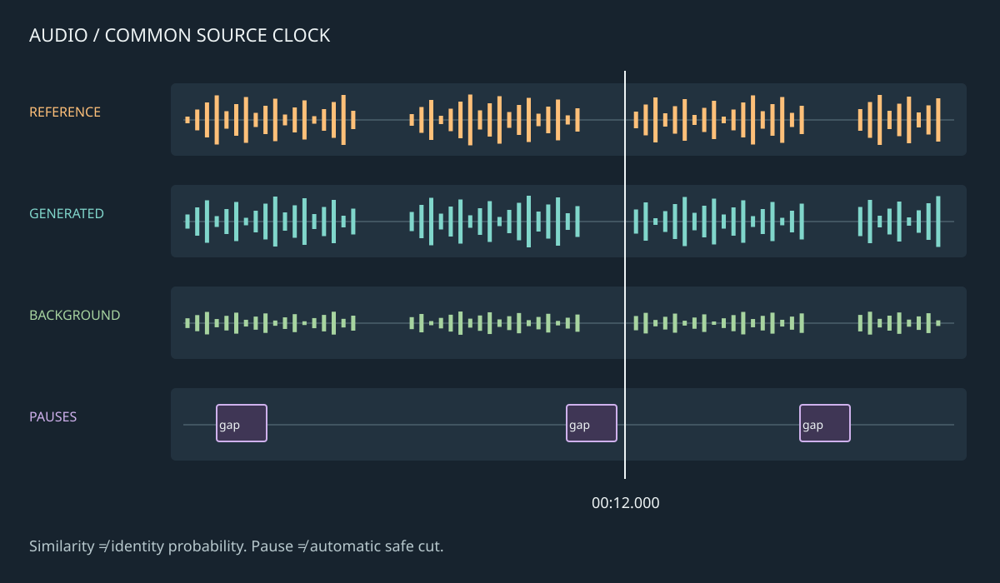

# Analysis, audio and synthesis

[Русский](Pipeline-ru.md) · [ag-media-studio](../../README.md)

## Source to evidence

- HTTP validates the request and forwards the source to `speech/media_transcript.py`.
- FFmpeg prepares audio. Sherpa groups voices; Whisper produces text and timestamps; selected problematic regions may receive a separate review pass.
- `vision/video_revolver.py` composes visual stages. YuNet detects faces, Light-ASD estimates active speaking, and optional layers depend on configured engines.
- `vision/video_scene.py` coordinates shots, OCR, objects, sampling and selective small-object passes.
- Graph ingest publishes compact nodes, edges and time windows. Preliminary results may be refined.

## Audio processing and comparison

Compare at the same position. Pause markers are edit candidates that still need auditioning.

| Module | Responsibility |
| --- | --- |
| `audio/audio_processing.py` | Denoising, EQ and a processed WAV copy |
| `audio/dialogue_pauses.py`, `audio/pauses.py` | Measured quiet intervals and cut candidates |
| `audio/audio_scene.py`, `audio/zipformer_audio.py` | Music and background events with platform-specific backends |
| `synthesis/auto_synthesis.py` | Attempts, evaluation, best-result selection and regression control |
| `synthesis/speaker_metric.py`, `speech_metrics.py` | Voice and speech metrics; a similarity value is not an identity probability |
| `synthesis/video_dub.py`, `dub_timing.py`, `dub_background.py` | Dubbing, duration fitting and background audio |
| `prosody/` | Stress/context preparation, syllable/morpheme graphs and targeted retries |

Cross-language cloning needs a separate listening check. Use the same seeds, sources and texts for A/B and retain experimental limits. Quality, latency and memory require separate measurements.

## Progress and limits

Done, skipped and failed are stage-specific states. A skip may reflect settings, unavailable engines or missing applicable data. Preserve coverage and provenance in the graph. This guide does not claim every layer operates in realtime on every device.

- [Models and dependencies](Models-and-storage.md)
- [Agent contract](Agents.md)
